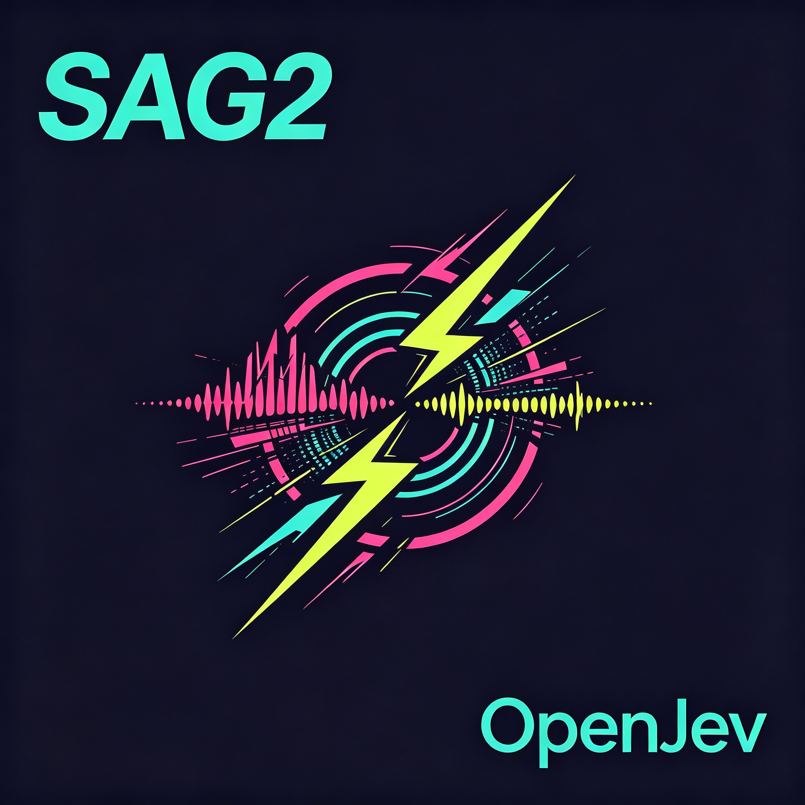

# OpenJev-SAG2

<p align="center">
  
</p>

**面向多跳证据检索的 OpenJev 决策头与 SAG2 可复现实现**

本仓库把 OpenJev-lite 的 9B 联合决策头接入 SAG2 的
BM25 召回、必要证据判断、词项扩展与 DPP 重排流程。模型不进行自回归文本生成：
共享状态只编码一次，每个候选段落独立判断是否为必要证据，最后直接读取训练头
给出的概率。仓库保留运行、服务和多跳检索评测所需的核心模块。

## 实验摘要

实验使用 `D:\SAGDataset` 中的 2WikiMultiHopQA、HotpotQA 与 MuSiQue。
每套数据固定抽样 20 个问题，共 60 个配对查询。给定每条问题自带的候选段落，
任务是检索 supporting facts：

- 2WikiMultiHopQA：`dev.parquet`
- HotpotQA：`validation-00000-of-00001.parquet`
- MuSiQue：`musique_ans_v1.0_dev.jsonl`

所有系统使用完全相同的查询、候选段落、金标标题与评测代码。

| 数据集               |     BM25 nDCG@10 | BGE-M3 nDCG@10 |  9B-SAG2 nDCG@10 |
| -------------------- | ---------------: | -------------: | ---------------: |
| 2WikiMultiHopQA      |           0.7975 |         0.9189 | **0.9249** |
| HotpotQA             | **0.9562** |         0.9448 |           0.9481 |
| MuSiQue              |           0.5989 |         0.7478 | **0.8002** |
| **三集宏平均** |           0.7842 |         0.8705 | **0.8910** |

完整结果见 [SAGDATASET_RESULTS.md](results/SAGDATASET_RESULTS.md)，
逐查询指标、耗时和 token 用量见
[sagdataset_9b.json](results/sagdataset_9b.json)、
[sagdataset_bge-m3.json](results/sagdataset_bge-m3.json) 与
[sagdataset_bm25.json](results/sagdataset_bm25.json)。

主要观察：

- 9B-SAG2 的三集宏平均 nDCG@10 最高，为 **0.8910**。
- 9B-SAG2 在 MuSiQue 上从 BM25 的 0.5989 提升到 **0.8002**，
  Recall@2 从 0.5000 提升到 **0.7500**。
- BGE-M3 在 2WikiMultiHopQA 上达到 0.9189，接近 9B-SAG2 的 0.9249。
- HotpotQA 的 BM25 很强，BGE-M3 的 nDCG 略低，但 MRR@10 达到 **1.0000**。

## 仓库结构

```text
OpenJev-SAG2/
├── logo/
│   └── logo.png             # 项目标识
├── openjev/                 # 决策骨干、共享状态、slot_head 与语言模型接口
├── sag2/                    # SAG2 算法、数据加载、Dense Retriever、指标
├── models/
│   └── 9b-mix/              # 9B 训练头 readout.pt + card.json
├── results/                 # SAGDataset 原始结果与逐查询明细
├── scripts/
│   ├── main.py              # 单查询本地 CLI
│   ├── serve.py             # /v1/decide 本地服务
│   └── evaluate_sagdata.py  # BM25/BGE-M3/9B-SAG2 配对评测
├── tests/                   # 轻量单元测试
└── config.yaml              # SAG2 检索参数
```

训练头已随仓库迁移；Qwen3.5 与 BGE-M3 骨干因体积较大不复制，默认路径为：

- OpenJev 9B：`C:\qwen3.5-9B`
- BGE-M3：`C:\bge-m3`

可通过 `--model`、`--checkpoint` 和 `--model-path` 指定其他本地路径。

## 环境

实验环境为 Python 3.11、PyTorch 2.6.0、Transformers 5.14.1、单卡 RTX 3090。

```powershell
Set-Location D:\OpenJev-Sag2
python -m pip install -r requirements.txt
python -m pytest
```

读取 Parquet 数据需要 `pyarrow`，已列入依赖。英文与中文词项切分均不依赖
`rjieba` 原生扩展。

## 单查询运行

9B 使用完整 GPU BF16：

```powershell
python -m scripts.main `
  --corpus corpus.example.json `
  --query "Who directed the film and who directed that director's parent?" `
  --model 9b `
  --batch 4
```

## HTTP 服务

```powershell
python -m scripts.serve --model 9b --port 8300
```

服务提供 `GET /healthz` 与 `POST /v1/decide`。请求格式与 QwenJev/OpenJev
原生决策格式一致：

```json
{
  "state": "The shared multi-hop question state.",
  "questions": {
    "candidate": {
      "type": "bool",
      "instructions": "Is this passage necessary evidence?",
      "criteria": {
        "true": "Yes",
        "false": "No"
      }
    }
  }
}
```

## SAGDataset 评测

快速复现 BM25 与 BGE-M3：

```powershell
python -m scripts.evaluate_sagdata `
  --systems bm25,bgem3 `
  --queries 20 `
  --seed 0
```

9B-SAG2 使用完整 GPU，不使用 CPU layer offload：

```powershell
python -m scripts.evaluate_sagdata `
  --systems 9b `
  --queries 20 `
  --seed 0 `
  --batch 4 `
  --max-batch-tokens 2048 `
  --candidate-k 20 `
  --seed-k 5 `
  --max-hops 2 `
  --expansion-terms 8
```

仅重建 Markdown 汇总：

```powershell
python -m scripts.evaluate_sagdata --report-only
```

## 数据口径

- 从 `D:\SAGDataset` 直接读取本地 Parquet/JSONL，不把数据复制进仓库。
- 数据来源：
  [MuSiQue](https://huggingface.co/datasets/bdsaglam/musique)、
  [2WikiMultiHopQA](https://huggingface.co/datasets/xanhho/2WikiMultihopQA)、
  [HotpotQA](https://huggingface.co/datasets/hotpotqa/hotpot_qa)。
- 2WikiMultiHopQA 的 context 与 supporting facts 从 JSON 字符串解析。
- HotpotQA 使用 context 标题与段落；仅保留 supporting title 确实出现在同条
  context 的样本。当前 validation parquet 中可用约 28%，避免缺失金标导致假失败。
- MuSiQue 使用 `is_supporting` 标记，跳过 `answerable=false`。
- 每个 supporting title 映射为相关文档；二跳问题通常有两个金标，三跳问题可能有三个。
- 指标为文档级 `nDCG@10`、`Recall@2`、`Recall@10` 和 `MRR@10`。
- 固定 `seed=0` 抽样，9B-SAG2、BGE-M3 与 BM25 使用完全相同的 query id。

## 运行速度

模型加载时间：BGE-M3 为 **5.1 秒**，OpenJev-9B 为 **26.0 秒**，BM25 无模型加载。
下表为每组 20 个问题的实测值；查询均值、中位数和 p95 均不含模型加载，
但包含该查询对应的在线检索计算。

| 数据集 | 系统 | 上下文索引 p50 | 查询均值 | 查询 p50 | 查询 p95 | 20 查询总耗时 | QPS |
| --- | --- | ---: | ---: | ---: | ---: | ---: | ---: |
| 2WikiMultiHopQA | BM25 | 1.4 ms | 0.27 ms | 0.25 ms | 0.36 ms | 0.01 s | 3746.44 |
| 2WikiMultiHopQA | BGE-M3 | 57.7 ms | 28.7 ms | 22.8 ms | 27.0 ms | 0.57 s | 34.88 |
| 2WikiMultiHopQA | 9B-SAG2 | 2.0 ms | 9552.9 ms | 6935.4 ms | 24755.5 ms | 191.06 s | 0.10 |
| HotpotQA | BM25 | 2.0 ms | 0.33 ms | 0.31 ms | 0.49 ms | 0.01 s | 2990.97 |
| HotpotQA | BGE-M3 | 59.0 ms | 22.4 ms | 22.0 ms | 26.3 ms | 0.45 s | 44.66 |
| HotpotQA | 9B-SAG2 | 2.0 ms | 6501.7 ms | 6231.7 ms | 9534.0 ms | 130.03 s | 0.15 |
| MuSiQue | BM25 | 3.3 ms | 0.42 ms | 0.42 ms | 0.59 ms | 0.01 s | 2386.07 |
| MuSiQue | BGE-M3 | 102.1 ms | 21.5 ms | 20.8 ms | 25.7 ms | 0.43 s | 46.61 |
| MuSiQue | 9B-SAG2 | 3.4 ms | 19045.3 ms | 17289.6 ms | 37518.1 ms | 380.91 s | 0.05 |

9B-SAG2 在线查询包含 BM25 初排、最多两轮扩展、OpenJev 判断与 DPP 重排，
不能只归因于模型前向。三套数据共产生 250 次请求、876 次候选判断，
处理 **194,156 个输入 token** 和 **16,410 个输出 token**。

## 复现性边界

- 每套数据仅固定抽样 20 个问题，适合真实链路验证和趋势观察，
  不代表三套 benchmark 的官方完整榜单结论。
- 评测对象是 supporting paragraph 检索，不包含最终答案生成。
- 9B 是 zero-shot retrieval：未使用训练集为动态检索问题拟合检索专用槽位。
  当前 mix 训练头的槽表不含这些问题 ID，因此 `slot_head` 按设计回退到保留
  A/B 行。结果不是 SAGDataset in-domain 微调后的上限。
- HotpotQA 的有效样本按 supporting title 可检索性过滤；官方全量数字可能不同。

## 版权与来源

本仓库延续并整合以下开源工作：

- SAG2 地址: https://github.com/Zleap-AI/SAG-Wiki
- Qwen3.5: https://huggingface.co/collections/Qwen/qwen35
- rjieba: https://github.com/messense/rjieba-py
- BGE-M3 地址: https://huggingface.co/BAAI/bge-m3

以下完整内容由 `THIRD_PARTY_NOTICES.md` 合入，并同时保留在
`THIRD_PARTY_NOTICES.md` 与 `相关版权.txt`。

### Third-party notices

This repository contains code derived from SAG2 and QwenJev-lite. Both
upstream projects are distributed under the MIT License.

#### SAG2

Source: https://github.com/Zleap-AI/SAG-Wiki

Copyright (c) 2026 Saturn_Aura

#### QwenJev-lite

Copyright (c) 2026 zhenyu.tong2

#### MIT License

Permission is hereby granted, free of charge, to any person obtaining a copy
of this software and associated documentation files (the "Software"), to deal
in the Software without restriction, including without limitation the rights
to use, copy, modify, merge, publish, distribute, sublicense, and/or sell
copies of the Software, and to permit persons to whom the Software is
furnished to do so, subject to the following conditions:

The above copyright notice and this permission notice shall be included in all
copies or substantial portions of the Software.

THE SOFTWARE IS PROVIDED "AS IS", WITHOUT WARRANTY OF ANY KIND, EXPRESS OR
IMPLIED, INCLUDING BUT NOT LIMITED TO THE WARRANTIES OF MERCHANTABILITY,
FITNESS FOR A PARTICULAR PURPOSE AND NONINFRINGEMENT. IN NO EVENT SHALL THE
AUTHORS OR COPYRIGHT HOLDERS BE LIABLE FOR ANY CLAIM, DAMAGES OR OTHER
LIABILITY, WHETHER IN AN ACTION OF CONTRACT, TORT OR OTHERWISE, ARISING FROM,
OUT OF OR IN CONNECTION WITH THE SOFTWARE OR THE USE OR OTHER DEALINGS IN THE
SOFTWARE.

项目代码采用 MIT License。MIT 许可要求的版权声明与许可声明已随源代码一并保留。
